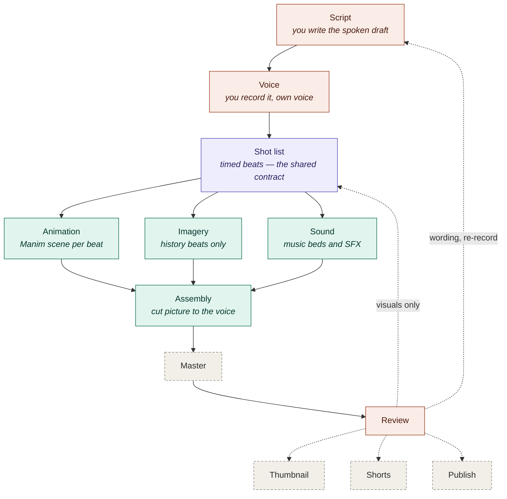

# Video pipeline v2 — workflow map

Draft 3, 2026-08-06. Tool bindings verified on this machine (DGX Spark, GB10,
aarch64) unless marked otherwise. Redraw this file as the design changes.

## The map



Coral = you. Teal = agent. Purple = the shared contract. Dashed = not built yet.
Interactive version: `map/index.html`, served on :8831 (`pipeline-map` in
`.claude/launch.json`).

## Amendments — 2026-08-19

Five decisions changed and five statements above went stale. The rest of this
file still holds; read these first where they conflict.

**1. "Your voice, no AI VO" → scratch TTS is a first-class stage.** The reason
voice-first existed was that nothing else could tell you a beat's true length.
Local TTS can, so the whole edit is now buildable before anything is recorded.
A real take at `voice/takes/<beat>.wav` always wins — by **file precedence, not
a mode flag**, so there is no scratch mode to leave switched on by accident.
Clone your own voice (drop ~10s at `voice/reference.wav`) and the scratch
timing closely matches the read you will actually give.

**2. This resolves the open question "voice-first vs animatic-first" as
animatic-first.**

**3. "Deliberately one-way" → an explicit, opt-in round trip.** The v1 failure
being guarded against was the editor becoming a *silent* second source of
truth. That is now prevented by splitting authority rather than by refusing the
trip:

| Document | Authoritative for |
|---|---|
| `shotlist.json` | **content** — which beats exist, what they say, which scene renders |
| `out/<slug>.edit.otio` | **time** — durations, trims, order |

`promote_timeline` is the single act that creates the edit copy; the pipeline
never overwrites it, and every mutating MCP tool refuses to touch an unpromoted
timeline. Promotion does **not** snapshot media — it records each clip's
content hash, so a later re-render is *detected* (`check_edit_drift`) instead
of being silently swapped underneath the edit.

**4. `retime` resolved: VO duration is the contract, picture yields.** `fit`
makes every clip exactly as long as its beat takes to say, so the timeline
needs no opinion in the normal case. `retime` is the deliberate override, it
can only shorten, and it moves picture and narration **together** — moving one
alone desyncs the tracks and the render is cut to the shorter of the two.

**5. `derive_short` resolved: re-render, never crop.** A 16:9 Manim composition
has no safe 9:16 crop. Still unbuilt, now blocked on the imagery node.

### Stale statements above

- **"Manim env missing / `manim_render.py` orphaned"** — false. ManimCE 0.20.1
  works; `setup_manim.sh` had been run.
- **"No ffmpeg installed"** — no *system* ffmpeg, but `config.ffmpeg()` falls
  back to the Manim env's **8.1.2 with full h264/hevc/av1 NVENC**. That
  fallback is load-bearing, not a nicety.
- **`MMS_FA`** — never adopt it, not even temporarily. Its weights are
  CC-BY-NC. `WAV2VEC2_ASR_BASE_960H` is MIT, same API, already present.
- **"ComfyUI is a yak-shave on aarch64"** — now stale (NVIDIA ships a DGX Spark
  playbook), but irrelevant: plain `diffusers` is still the right call for a
  scripted pipeline, and it is already installed.
- **"No microphone"** — still true, now irrelevant. Takes are recorded
  elsewhere and copied in; nothing in the pipeline captures audio.

### All thirteen nodes now exist

```
beats → animation ┐                        ┌→ captions (.ass + .srt)
                  ├→ fit → timeline → master
        imagery  ─┘         ↑    ↑     ↑   └→ short (9:16) → thumbnail → publish
        voice → align ──────┘    │     │
        sound ───────────────────┘─────┘
```

`doit` default tasks, in order: `beats animation imagery voice align fit
timeline sound captions master short thumbnail publish`.

Six decisions worth keeping from building the last five:

1. **A bed with no sidecar is refused.** Not warned about — refused. There is
   no local music model safe to ship (MusicGen, AudioGen, AudioLDM 2 and
   Tango 2 all pair permissive code with CC-BY-NC weights), so beds are curated,
   and a curated bed whose licence was never written down is the expensive kind
   of unknown.
2. **Loudness is measured exactly once**, over the finished mix with the bed in
   it. Per-beat normalisation was wrong twice over — EBU R128 gating is
   meaningless on a 3-second fragment (it landed 5 LU under target), and it
   flattens the dynamics between beats.
3. **Captions are written by hand, not via pysubs2.** Emitting ASS is a hundred
   lines of formatting, and every caption tool in the ecosystem is a Whisper
   wrapper bolted to an ASS templater — we would adopt the half we do not need
   and fight the half we do. Cue times come from the TIMELINE, so a reorder
   moves them.
4. **A Short is authored, never inferred**, and re-rendered at 1080x1920 rather
   than cropped.
5. **Thumbnail type is sized to what fits.** Breaking on character count and
   then setting at a fixed size ran the first version off the canvas — 22
   characters is one short line by count and 1200px wide at 92pt.
6. **The upload stays manual.** YouTube's Data API requires OAuth; this is the
   one node where local-first cannot be met, so the pipeline emits
   `out/publish.md` and a person presses publish.

### Two traps found in the building

- **Iterating a temporary OTIO Timeline yields nothing, silently.**
  `for t in read_from_file(p).tracks:` finds zero items — the Stack does not
  keep its parent alive — and it does not raise. Bind the timeline to a name.
- **A `file_dep` added only "if the file exists" never comes to rest.** doit
  treats a changed dependency SET as a change, so the task is stale immediately
  after the build that created the file. Declare the dep unconditionally when
  another task targets it.

### The finding that made all of this cheap

`~/Desktop/code/reachy-chatterbox/` — a venv built for the Reachy robot —
already carries the entire media toolchain this file planned for, working on
aarch64 + CUDA 13.0 + sm_121:

    torch 2.13.0+cu130 · torchaudio 2.11.0+cu130 (forced_align present)
    MMS_FA + WAV2VEC2_ASR_BASE_960H · chatterbox 0.1.7 · kokoro-onnx 0.5.0
    diffusers · transformers 5.2.0 · onnxruntime 1.27.0 · soundfile

Chatterbox and Kokoro weights are already in the HF cache. So `VOICE_ROOT`
follows the `MANIM_ROOT` pattern exactly: a fat sibling env we shell into via a
stdlib-only bridge (`bridges/voice_render.py`), never import. **The pipeline's
own `.venv` is still doit + mcp + otio, plus pytest.**

Two things to know about that env: `torchaudio.load` now routes through
TorchCodec, which is not installed, so the bridge reads WAV with `soundfile`;
and `WAV2VEC2_ASR_BASE_960H` emits **logits**, so `forced_align` needs a
`log_softmax` first — without it the timings still look right and the
confidence scores are meaningless, which is the dangerous failure.

## Decisions locked

1. **A video is one folder of plain files.** No database, no project binary.
2. **`doit` is the orchestrator** — 460 KB, 3 packages, no daemon, no server.
   Beats are discovered from the filesystem, so the shot list stays the only
   source of truth. Verified: edit beat07 → only beat07 and master rebuild; add
   beat08 → discovered with no registration step.
3. **The canvas is `map/index.html`, wired read-only to `doit list --status`.**
   No execution logic in the UI. Dagster was the alternative — it is the only
   surveyed tool giving a node graph, freshness badges and click-to-rematerialize
   for free — but it costs 151 MB, 72 packages and 6 daemons, and Prefect acquired
   Dagster Labs in July 2026. Revisit only after two or three real episodes.

```
videos/<slug>/
  script.md          you write this
  beats/beat07.json  per-beat fragments — NOT one monolithic file (see traps)
  vo/                recorded voice, per beat
  assets/            beat-keyed output from animation / imagery / sound
  out/               master
```

## Tool bindings

| Node | Tool | Notes |
|---|---|---|
| Script | Obsidian + local Ollama | already yours |
| Voice | `ffmpeg -f pulse` capture; Audacity 3.7.8 **via Flathub** | official AppImages are x86-64 only; Audacity 4.0 beta has no ARM64 build |
| Clean | `afftdn` with a captured room profile → DeepFilterNet3 `-a 12` as escalation | ML denoise is the *second* reach, not the first — it pumps on breaths and sibilants |
| **Align** | `torchaudio.functional.forced_align` + MMS_FA | ✅ ran on GB10, CPU + CUDA, wheels already cached. ~150 lines of glue; nothing off-the-shelf does this job |
| Shot list | per-beat JSON fragments, write-if-changed | plain files, no schema library |
| Animation | ManimCE 0.20.1 (conda-forge) + **`manim-voiceover`** | scenes wait on `\bookmark` marks in your own recording |
| Imagery | plain `diffusers` + Qwen-Image (Apache-2.0) | **not ComfyUI** — see traps |
| Sound | YouTube Audio Library → Incompetech → Pixabay; Stable Audio Small for SFX | curate music, generate SFX |
| Assembly | OTIO 0.18.1 as the model → ffmpeg/NVENC as renderer | segment-then-concat: normalise each shot to one profile, then `-c copy` |
| Escape hatch | **Kdenlive 26.04.3** (Flatpak, user scope) | installed; see the OTIO note below |
| Loudness | `ffmpeg-normalize` two-pass, `-t -14 -tp -1 -ar 48000` | add `--keep-loudness-range-target --auto-lower-loudness-target` |
| Captions | emit from the same alignment + pysubs2 | don't transcribe — you have the script |
| Thumbnail | Jinja2 → SVG → resvg | diffusion for backgrounds only |
| Trim takes | `auto-editor` static aarch64 binary | from GitHub releases; PyPI is two majors stale |

**Hardware facts established on-metal:** the GB10 has a **full NVENC engine**
(H.264, HEVC, AV1) plus NVDEC — the common "ARM64 Blackwell has no NVENC" claim is
true of A100/H100 and false here. `torchaudio` 2.11.0+cu130 executes the sm_121
alignment kernel.

## What exists (2026-08-06)

The spine runs end to end. `doit` (0.37.0) in `.venv`, 2 packages.

```
dodo.py               tasks: beats -> animation -> master
pipeline/config.py    paths; prefers system ffmpeg, falls back to the NVENC-capable Manim env one
pipeline/beats.py     shotlist -> per-beat, per-NODE fragments, write-if-changed
pipeline/animation.py delegates to the carried-over manim_render.py; never forks it
pipeline/assemble.py  concat demuxer, stream-copy, no re-encode
map/index.html        the canvas; data-driven, adding a node is one object
map/serve.py          read-only status server on :8831, zero deps
videos/<slug>/        one production: shotlist.json authored, everything else derived
```

**The canvas shows state and opens doors — it still cannot build.** `map/serve.py`
serves the page plus `/api/status` (derived from `doit list --status`) and
`/api/open`. Nodes carry a fresh/stale badge, and selecting one lists its tasks,
so a single stale beat is visible as `animation:demo/b03 stale` rather than
hiding inside a green pipeline. Execution stays in the CLI: v1's failure mode
was not weight, it was that nothing showed you state.

**The canvas is the v3 hourglass** (13 nodes): script and voice feed the shot
list, three generators fan out, everything converges on the timeline with the
agent and Kdenlive flanking it bidirectionally, and master/shorts/thumbnail
derive from it into publish.

`POST /api/open {node, slug}` opens a node's door — `timeline` launches Kdenlive,
`master` opens the mp4 in the default player. The security model is the
allowlist: the client sends a **node key and a slug, never a path and never a
command**, and every path is derived server-side from a fixed table. Verified
rejected — unwired nodes, `../../etc` as a slug, unknown endpoints. Launching is
**loopback-only**: reading status over the tailnet is fine, spawning processes
on this box is not.

Canvas nodes are real `role="button"` controls with `tabindex` and Enter/Space
handling. They were plain `div`s until 2026-08-07, which made the primary
controls of the page unreachable by keyboard and invisible to assistive tech.
Shift+Enter on a door node opens it; double-click does the same with a mouse.

Two defects found by clicking rather than by curling, both fixed: the 5s status
poll re-rendered the panel and wiped the launch message before it could be read;
and Kdenlive does not single-instance itself under Flatpak, so repeated clicks
spawned an editor each time (five, during testing). `already_running()` now
checks `flatpak ps` first.

**Two levels of granularity, both required.** Per-beat fragments stop one edit
invalidating all 80. Per-*node* projections (`b02.animation.json`,
`b02.vo.json`) stop a narration retouch re-rendering an animation that never
reads `vo_text`. Verified: rewording narration rebuilds nothing; swapping a
beat's scene rebuilds that beat only; editing a Manim `.py` rebuilds exactly the
beats using it; adding a beat builds one clip and re-muxes; deleting a beat
prunes its fragments and drops it from the master.

Adding a generator = adding an entry to `beats.PROJECTIONS`. That is the "new
field, not a new pathway" rule made mechanical.

**Known gap:** deleting a beat prunes its fragments but leaves `assets/<id>.mp4`
orphaned on disk. Harmless — assembly walks the shot list, not the directory —
but it is disk cruft `doit clean` cannot reach, since the task no longer exists.

**Fixed 2026-08-07 — silent staleness.** `file_dep` listed only the scene `.py`,
but all 55 scenes do `from scm_style import ...`. Editing the shared visual
language (colours, fonts, the `SCMScene` base class) changed every render while
invalidating nothing, so doit reported everything fresh and served stale clips.
`animation.scene_sources()` now walks the AST for a transitive import closure of
modules under `MANIM_ROOT`. Verified: fresh → all four beats stale on a
`scm_style.py` edit → fresh again on restore.

**Still unfixed, same family:** `manim_render.py` names its output
`out/<stem>_<scene>.mp4` with no resolution, fps or quality in the name. Render
one scene at 1080p then 720p and the second silently overwrites the first.

## The editor (verified 2026-08-07)

**Kdenlive 26.04.3**, Flatpak user scope (`flatpak install --user flathub
org.kde.kdenlive`, no sudo). apt ships 23.08.5, which predates OTIO support
entirely. The sandbox declares `filesystems=host`, so it reads clips under
`~/Desktop` without extra permissions, and it pulled in the NVIDIA GL extension.

Chosen over Shotcut because it bundles **libopentimelineio 0.18.1 — the exact
version we write with** — so OTIO needs no adapter and cannot skew. Shotcut
wants `.mlt`, and OTIO's `mlt_xml` adapter is write-only and broken.

**Import is a GUI action.** Verified the hard way: passing a `.otio` on the
command line makes Kdenlive open an empty project and add the file as a bin
clip (`createClipFromFile`). There is no CLI flag and no `.otio` mimetype
registration. The path is:

    Project -> Import/Export -> OpenTimelineIO Project

So a canvas link can open Kdenlive, but cannot hand it the timeline — that
stays two clicks. The alternative is generating `.kdenlive` project XML
ourselves, which does open from the CLI but means owning MLT-XML generation and
its documented failure modes (`mlt_service`, `<chain>` vs `<producer>`,
`id="main bin"`) plus version drift. Not worth it for two clicks.

`OtioExport`/`slotExport` also exist, so Kdenlive can write OTIO back. We
deliberately do not consume it — see the one-way rule in `pipeline/timeline.py`.

## The MCP seam (scaffolding, 2026-08-07)

`pipeline/mcp_server.py`, entrypoint `run_mcp.sh`, registered in `~/.claude.json`
as `video-pipeline`. 10 tools; stdio handshake verified.

**The agent operates on OTIO, never on Kdenlive's GUI.** OTIO is JSON with a
Python API, so an agent can retime, reorder and derive directly on the file.
Kdenlive is the human's window onto that same document, and its `OtioExport`
brings hand polish back out in the same format. That shared file is the seam.

**This server never builds.** Execution stays in `doit`, so there is exactly one
way to produce an asset and the agent cannot become a second, divergent build
path. `pipeline_status` reports freshness; it does not fix it.

Implemented (reads): `list_videos`, `get_shotlist`, `get_timeline`,
`pipeline_status`, `open_in_editor`.
Stubs that raise with the decision they are blocked on: `promote_timeline`,
`retime`, `reorder`, `derive_short`, `apply_polish`. A stub that lies about
working is worse than no stub.

Note `mcp` 2.0 renamed `FastMCP` to `MCPServer` and moved it to `mcp.server`;
`mcp.server.fastmcp` no longer exists.

## Asset libraries (scaffolding, 2026-08-07)

**Adopt nothing.** AYON is amd64-only across all 157 tags, relicensed away from
open source in Jan 2025, with the solo-useful features behind a 5-seat minimum.
Kitsu runs on ARM64 but manages coordination between humans — near-zero value at
n=1. No DAM fits: every photo-centric tool would render three of the five
libraries invisible, and exiv2's PNG parser recognises only five keys, so
digiKam/Immich/PhotoPrism are *architecturally* blind to generation parameters.

**One sidecar JSON per asset is the truth; any index is a derived cache.**
Forced by measurement, not taste: on this box Pillow silently drops every PNG
text chunk on save, ffmpeg's PNG encoder cannot write them at all, and mixing a
licensed track into a render destroys its tags outright. Embedded metadata does
not survive our own pipeline.

The split is deliberately **not uniform**:

| Medium | Lives | Why |
|---|---|---|
| script | `videos/<slug>/script.md` | one video only; the sole medium git handles natively |
| voice | `videos/<slug>/voice/` | not reusable, but takes are worth keeping — a performance is unrepeatable |
| animation | `~/Desktop/code/manim` | already a library; the **source** is the asset, the mp4 is a cache |
| imagery | `libraries/imagery/` | a period portrait is reusable across a series |
| sound | `libraries/sound/` | a bed is reusable across twenty videos |

`pipeline/library.py` holds the whole convention: `rights()` (SPDX id **with
version**, landing URL not file URL, and a `modified` flag for CC-BY 4.0
§3(a)(1)(B), which the usual TASL formula omits), `provenance()` (IPTC
`DigitalSourceType` — `algorithmicMedia` for Manim, `trainedAlgorithmicMedia`
for diffusion/TTS), and `credits()`, which emits **only** what is actually owed.
`cas_put` and `index_rebuild` are stubs that raise with the decision each is
blocked on — content-addressing with one consumer is speculative generality, and
zero of the 198 existing renders are byte-identical duplicates.

`.gitignore` tracks sidecars while ignoring media (`!videos/*/assets/*.json`).
Verified by clone: `script.md` and sidecars come across, media does not.

**Styles (2026-09-01, v0.12.0):** a module's timing, grade, letterbox, chapter
tag, music defaults and narration delivery come from `libraries/styles/<id>.json`,
bound in the registry and overridable per shot list; the shot list's own blocks
win field by field. `beats.effective()` is what the pipeline reads. A shipped
style is immutable — fork it.

**Closed 2026-09-01 (The Studio, rung 1):** `vo_text` now compiles from the
vault screenplay — `pipeline/screenplay.py`, bound by the shot list's `script`
field. The script owns narration, order and `brief`; recipes stay untouched.
`visual.kind: "brief"` renders a placeholder card so an animatic builds before
any art exists. And `MMS_FA`, the alignment model, is
CC-BY-NC; swap to `WAV2VEC2_ASR_BASE_960H` (MIT) before monetising.

**Manim's own cache is source-verified blind** — `get_hash_from_play_call`
hashes camera, animations and current mobjects, never the scene file, and
manim's version is not in the key. Render with caching off and rely on our
`file_dep` closure instead.

## Traps

- **A monolithic `shotlist.json` invalidates every beat.** No timestamp or
  whole-file hash can see that only beat 7 changed. Emit per-beat fragments or
  incremental re-render dies. This applies to every orchestrator, not just `doit`.
- **Don't trust Manim's own caching for correctness** — widely reported as overly
  persistent. That's why `--disable_caching` exists.
- **The code/weights licence split.** Meta's AudioCraft repo is MIT but every
  weight in it (MusicGen, AudioGen, MAGNeT) is CC-BY-NC-4.0. Running MIT code does
  not launder NC weights. AudioLDM 2, Tango 2 and Tencent SongGeneration fail the
  same way. **MMS_FA alignment weights are also CC-BY-NC** — swap to
  `WAV2VEC2_ASR_BASE_960H` if the channel is monetised.
- **The inverse trap:** FLUX.1/2 `[dev]` reads "Non-Commercial" but restricts
  *hosting the model*, not the pictures. Outputs are explicitly fine commercially.
- **ComfyUI is a yak-shave on aarch64** — no `xformers` wheels, `flash-attn` needs
  a ~75 min source build, no `onnxruntime-gpu`, plus a double-memory bug. Both
  DGX-Spark forks ship **no LICENSE file at all**.
- **`ffmpeg loudnorm` silently reverts `linear=true` to dynamic** (compressing your
  VO) when input LRA exceeds target. Use `ffmpeg-normalize`, which handles it.
- **CTranslate2 aarch64 wheels are CPU-only**, which takes faster-whisper and
  WhisperX with them. Treat any dependency on them as unbudgeted research.
- **Record licence, attribution and source URL next to every audio asset** at fetch
  time. YouTube processed 2.5B Content ID claims in 2025 and false claims on
  royalty-free music are a documented pattern; >65% of disputes resolve for the
  uploader, so this turns an archaeology project into a lookup.

## Blocked on hardware

- **No microphone.** `arecord -l` is empty; only the NVIDIA HDMI controller is
  present. **No longer blocking** — scratch TTS exercises the pipeline end to
  end, and real takes are recorded elsewhere and copied into
  `voice/takes/`. Nothing here captures audio, so no interface is required.
- ~~No ffmpeg installed.~~ Resolved — see the amendments.
- ~~Manim env missing.~~ Resolved — ManimCE 0.20.1 works.

## Ecosystem survey — 2026-08-19

Star counts and last-push dates verified live. The traps matter more than the
picks, because several are top search results that look maintained.

**Do not adopt.** `WhisperX` / `faster-whisper` — CTranslate2 publishes no
CUDA-enabled aarch64 wheel and falls back to CPU *silently*
([speaches-ai#620](https://github.com/speaches-ai/speaches/issues/620), open).
`stable-ts` is **archived**. `ffmpeg-python` is dead since 2024-08 (11k★, not
archived). `coqui-ai/TTS` is dead — the company shut down; the live fork is
`idiap/coqui-ai-TTS`. `rhasspy/piper` is **archived**; its successor
`piper1-gpl` relicensed **MIT → GPL-3.0**. `F5-TTS` is MIT in the repo and
**CC-BY-NC in the weights** — GitHub's licence field hides it.
`ctc-forced-aligner` has **no licence file at all**. `auto-editor` is now
licence-key gated for multi-source export — and unnecessary here, because the
alignment already says where the silence is. `ClipsAI`, `captacity`,
`jumpcutter`, `ShortGPT` are all abandoned.

**Not worth adopting even though they work.** Every Shorts tool exists to infer
structure from an unstructured podcast; the shot list *already encodes* what
they try to guess. `MoneyPrinterV2`/`ShortGPT` have no timeline model and no
caching — this spine is strictly more capable. `manimgl`'s 91k★ is a YouTube
artifact; migrating 55 scenes is pure downside.

**`manim-voiceover`: take the idea, not the dependency.** Its `<bookmark>`
convention is genuinely good and is now supported — marks are stripped from
`vo_text`, resolved against the alignment, and emitted as
`bookmarks: {name: seconds}`. The library itself wants to own scene structure,
which fights the beat spine, and its only keyless TTS options are the dead
Coqui and a service its own docs rate "Bad".

**Confirmed picks.** Kdenlive is not a compromise — **DaVinci Resolve has no
Linux ARM64 build at all**, so it is the only real NLE on this box, and it
happens to link the exact OTIO we write. For keyless stills, the sources that
need no API key are Wikimedia Commons, NASA, Openverse and the Internet Archive
(Pexels/Pixabay/Coverr all require one) — and for this channel they are better
anyway: you want Euler's diagram, not a drone shot.

**Publishing has no keyless path.** YouTube's Data API requires OAuth. Emit the
metadata and press publish by hand.

## Open questions

- What lives inside the animation node — scene selection, codegen, render,
  retry-on-error. Prior art to mine: `manim-mcp-server` (keyless by design),
  `Math-To-Manim`, `TheoremExplainAgent`'s planner. None are local-first and
  mature; all are cannibalise-not-adopt.
- Whether `fit`'s frame-hold is good enough, or whether beats that run long
  under narration should re-render with the animation slowed instead.
- Take selection across multiple recordings of the same beat. Nothing
  off-the-shelf ranks takes by quality; the alignment's confidence score plus
  duration closeness is the obvious local scorer, and it is ~150 lines.

## Why v1 died

`blender-vse-mcp` (deleted 2026-08-06) reached 3.3G and five rendering paths —
Blender VSE, Manim, Revideo, image-to-video b-roll, generated SFX — with no shared
contract, plus a dashboard to drive it. Nothing was separable, so nothing could be
replaced. The counterargument worth holding onto: weight was not the failure mode,
**invisibility** was. That is what decision 3 is buying.

## Carried over

`~/Desktop/code/manim/` — 55 scene sources, `scm_style.py`, `manim_render.py`,
102 renders, and `_old-repo-bundles/` (deletable).


## Credentials (added 2026-08-26, stems Phase 7)

The repo's first credential arrived with `bridges/elevenlabs_render.py`. The
rules, in the order they defend:

1. **Keys live in the environment, never in files this repo tracks.** The
   bridge reads `ELEVENLABS_API_KEY` at the last moment; `providers.resolve`
   refuses credential-shaped values in the registry with a warning.
2. **`.env` is gitignored at the repo root** (with `*.key`), added before the
   first key existed. There is no dotenv loader — the venv is deliberately
   thin — so load it in the shell: `set -a; source .env; set +a`.
3. **Spend is capped per run.** `ELEVENLABS_MAX_BEATS` (default 10, unset
   means the default, not unlimited) bounds how many beats one doit run may
   synthesise. The failure it guards is an invalidation accident
   re-synthesising a module, not extravagance.

## The revamp scene split (2026-08-27)

Each Logic module now has two scene files: `scenes/<module>.py` (the originals)
and `scenes/<module>_r.py` (what the narrative revamp added). The split is not
organisational tidiness — it is the invalidation contract. `_r.py` **imports**
from the original and never edits it, so the 130 clips already on disk stay
fresh while 178 new ones render beside them.

`scenes/revamp_kit.py` holds the vocabulary the added beats share. Most of the
runtime the revamp added is restatement, illustration and consequence rather
than new concepts, and that wants one dialect across six modules.

Two rules learned the hard way this cycle, both worth keeping:

- **Beat ids change when narration changes.** The revamp uses `rXX`. Reusing
  `bXX` would let `beats.split` write a fragment claiming a rendered clip
  matched text it never matched.
- **Reference archival plates by subject, not by beat id.** A plate pinned to
  `("classical-logic", "b03")` broke silently the first time a script downstream
  of it was rewritten.
